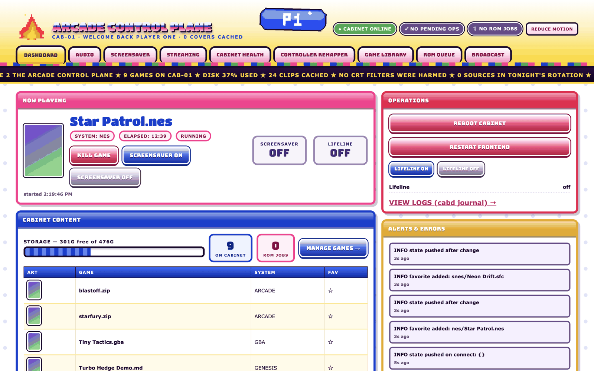
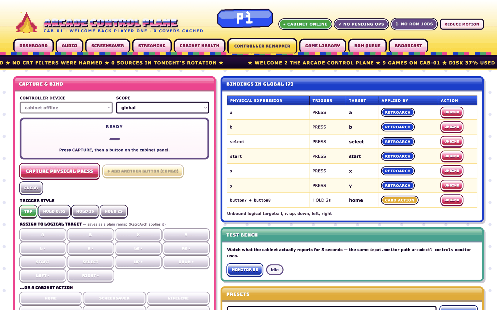
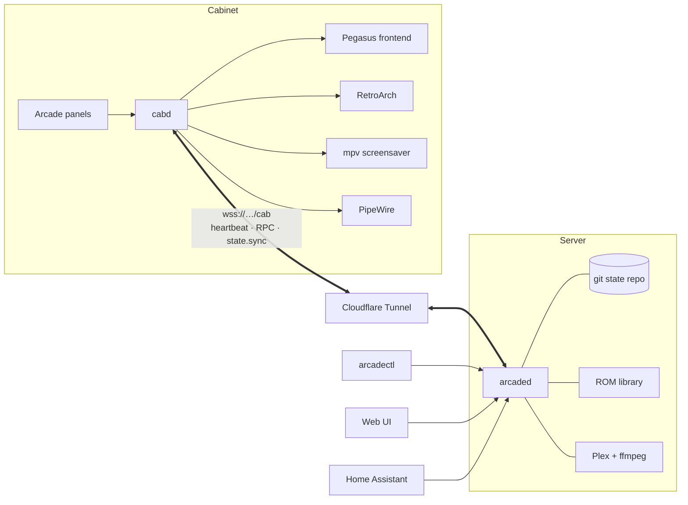

# Arcade Relay

**A remote-controlled arcade cabinet.** The cabinet in the living room runs
the games; a server somewhere else runs everything else. They talk over a
single outbound WebSocket, so you can remap buttons, dim the screensaver,
install a game or reboot the cabinet from a laptop, a phone, Home Assistant or
a coding agent, without ever plugging a keyboard into the cabinet.



Retro cabinets usually rot the same way: configs drift, a controller update
scrambles the layout, a game hangs and nobody can reach the menu, and every
fix means opening the back panel. Arcade Relay treats the cabinet as an
appliance and the server as the source of truth. Every setting is a commit in
a git repo, pushed to the cabinet and re-rendered into RetroArch and Pegasus
before every single launch. The cabinet plays perfectly with the network cable
cut, and heals itself the moment it reconnects.

## What it does

- **Unshakeable emulation.** Games launch through a supervisor with a watchdog:
  a crashed or hung game is back at the menu in under two seconds. Hold Start +
  Select anywhere to go home.
- **Config as code.** Controller maps, presets, audio policy, screensaver
  settings and favorites live in a git-backed state repo. `arcadectl state log`
  shows who changed what; `state rollback <sha>` undoes it.
- **A real controller remapper.** Press a physical button, pick a target or a
  cabinet action (home, save state, rewind, screensaver), choose tap or hold.
  Global, per-system and per-game layers; named presets; a live input monitor.
- **Two-player panels that never swap.** Raw encoder boards are calibrated and
  re-emitted as persistent virtual pads keyed by USB port, so player 1 stays
  player 1 through unplugs and mode changes.
- **Attract-mode screensaver.** After a few idle minutes the cabinet plays
  shows and movies from your Plex library, transcoded to 480p on the server,
  pan-scanned to fill a 4:3 screen, with live brightness from 0 to 200%,
  playlists, shuffle policies, English subtitles and optional retro commercial
  breaks. Offline, it falls back to local clips.
- **Game delivery with receipts.** `arcadectl roms request "Star Patrol" --system nes`
  finds the file in your server-side library, stages a sha256-verified copy,
  ships it through the tunnel, verifies it again on the cabinet, adds box art
  and rescans the frontend.
- **Streaming tiles.** Moonlight to a gaming PC on the LAN, Greenlight for
  Xbox cloud, and local Steam titles, all launched and killed like any game.
- **Lifeline mode.** A panel chord brings up a full-screen network diagnosis
  (link, internet, DNS, server) with recovery actions, no server required.
- **Agent-first.** One CLI, `--json` everywhere, stable exit codes, and
  `AGENTS.md` plus task skills in `skills/`, so a coding agent pointed at the
  server can "make the screensaver dimmer and turn off the anime" on its own.
- **Smart home.** Home Assistant entities over MQTT discovery (stop game,
  screensaver switch, now playing, CPU/GPU/temps) and Discord now-playing
  posts.
- **Self-updating.** Cabinet and server both fast-forward from git on a timer,
  never mid-game and never over local edits.



## How it fits together



- **`cabd`** (cabinet daemon, Python asyncio) owns the hardware: input and
  combos, launching and watchdogging games, rendering configs, the screensaver,
  audio policy and Lifeline. It caches the last state bundle so it boots and
  plays with no server.
- **`arcaded`** (server daemon, aiohttp) hosts the WebSocket hub and about 80
  REST routes. The CLI, the web UI and Home Assistant are all just clients of
  that API.
- **The link** is one WebSocket the cabinet dials out over Cloudflare Tunnel:
  5-second heartbeats, request/response RPCs, and a full state push on every
  change. Nothing listens on the cabinet's network.

The full design, module by module, is in [docs/architecture.md](docs/architecture.md).

## Quickstart (no hardware, no Docker)

Run the server and a pretend cabinet on your laptop. Needs Python 3.11+ and git.

```sh
git clone https://github.com/joey12725/Arcade-Relay && cd Arcade-Relay
python3 -m venv .venv && . .venv/bin/activate
pip install aiohttp pyyaml

make dev-server          # terminal 1: arcaded on :8000 with a scratch state repo
make demo-cabinet        # terminal 2: a fake cabinet dials in, a game is "running"
```

Open <http://localhost:8000/ui> for the web control plane, then drive it from
the CLI:

```sh
python3 server/arcadectl status
python3 server/arcadectl favorites add "nes/Star Patrol.nes"
python3 server/arcadectl --json screensaver set --brightness 60
python3 server/arcadectl state log          # every change above is a commit
```

## Tests

```sh
pip install pytest ruff
make test     # ~290 unit tests: combos, bindings, panels, ROM staging, playlists...
make lint
```

The Docker simulation rig runs the whole system with real Xvfb, mpv, PipeWire
and Plex, fake emulator binaries that open real X windows, and every packet
between cabinet and server routed through Toxiproxy for chaos:

```sh
make sim-up && make sim-test      # bring it up, smoke test
make accept-m0                    # milestone gates run through accept-m6
make soak-up && make soak-status  # hours of random partitions and kill -9s
```

## Deploying

**Server.** Either `sudo ./server/provision/install.sh` (systemd, port 8000) or
the Docker image (`docker build -f server/Dockerfile .`). Point `PLEX_URL` at
your Plex server for the screensaver and `ROM_SOURCE_DIR` at your game folder
(`<system>/<file>`, for example `nes/`, `snes/`, `psx/`). Put it behind a
Cloudflare Tunnel so the cabinet can reach it from anywhere.

**Cabinet.** Fresh Debian minimal, then:

```sh
sudo SERVER_HOST=arcade.example.com ./cabinet/provision/install.sh
```

That builds an Openbox kiosk with auto-login, installs `cabd`/`pegasus`/`steam`
as supervised user units, sets up udev rules for the encoders, and enables the
self-update timer. Step-by-step runbook: [docs/deploy.md](docs/deploy.md).
Hardware, panel layout and encoder setup: [docs/hardware.md](docs/hardware.md).

## Repository layout

```
cabinet/          cabd and its modules, provisioning, systemd units, udev rules
server/           arcaded, arcadectl, web UI, Plex/ROM/art/integration adapters
state/            the default config-as-code bundle (seeded into the state repo)
themes/           Pegasus themes: pegasus-y2k (main) and pegasus-redblue (fallback)
assets/           skins, sprites and the generated pixel-art GIF pack
skills/           task guides for agents driving arcadectl
sim/              Docker simulation rig, soak/chaos stack, acceptance scripts
tests/            pytest suite
docs/             architecture, spec, deploy runbook, hardware, acceptance record
```

## Tech stack

Python 3 (asyncio, aiohttp, PyYAML, python-evdev, paho-mqtt) · RetroArch ·
Pegasus Frontend with custom QML themes · mpv JSON IPC · PipeWire/WirePlumber ·
X11 + Openbox · systemd · Plex + ffmpeg · Cloudflare Tunnel · Moonlight,
Greenlight, Steam · Docker Compose + Toxiproxy for the simulation rig ·
vanilla JS single-file web UI · pytest + GitHub Actions.

## Docs

| Doc | What's in it |
| --- | --- |
| [architecture.md](docs/architecture.md) | How the pieces fit, the protocol, ROM delivery, self-update |
| [spec.md](docs/spec.md) | The original requirements and design decisions |
| [deploy.md](docs/deploy.md) | Server, tunnel and cabinet runbook |
| [hardware.md](docs/hardware.md) | Bill of materials, panel layout, encoders |
| [home-assistant.md](docs/home-assistant.md) | Home Assistant and Discord integrations |
| [acceptance.md](docs/acceptance.md) | Milestone gates and soak results |
| [milestones.md](docs/milestones.md), [assumptions.md](docs/assumptions.md), [hardware-checklist.md](docs/hardware-checklist.md) | Build plan, sim-vs-real judgment calls, on-hardware checks |
| [t3-setup.md](docs/t3-setup.md) | Turning the cabinet into a remote dev box for coding agents |

Games are not included. Bring your own: cartridges you've dumped, homebrew,
freeware releases.

## License

MIT. Built by [Joey Hersh](https://github.com/joey12725).
