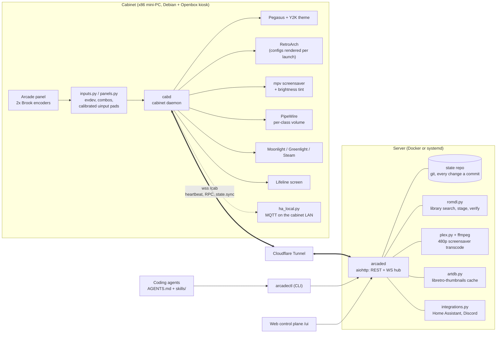

# Architecture

Arcade Relay is two daemons and a link between them. The cabinet runs `cabd`,
which owns everything physical: the panel, the emulators, the frontend, the
screen and the speakers. The server runs `arcaded`, which owns everything
that should outlive a reimage: configuration, the game library, media, art
and history. The cabinet dials out to the server over one WebSocket, so the
cabinet's network never needs an open port.



## The link

One persistent WebSocket, cabinet to server, JSON in both directions:

```
cabinet -> server  {"kind":"event","event":"heartbeat","interval":5,"state":{...}}
server  -> cabinet {"id":"<uuid>","kind":"req","method":"game.launch","params":{...}}
cabinet -> server  {"id":"<uuid>","kind":"res","ok":true,"result":{...}}
```

- **Heartbeats** every 5 s carry what is running, for how long, and whether
  the screensaver or Lifeline is up. Three missed beats and the server marks
  the cabinet offline.
- **RPCs** are request/response with a timeout. If the socket drops, every
  in-flight call fails immediately with a 503 instead of waiting it out.
- **Reconnects** use jittered exponential backoff capped near 10 s, forever.
  Newest connection wins, so a reconnect race never leaves a zombie socket.
- **Bulk bytes** (ROM deliveries, box art, screensaver video) go over plain
  HTTPS through the same tunnel, pulled by the cabinet and checksummed on
  arrival.

## Config as code

Every setting lives in `state/` on the server: audio policy, controller maps
and presets, screensaver sources and playlists, favorites, streaming tiles,
integrations. `arcaded` keeps it as a git repo and commits each change with a
readable message (`arcadectl: set screensaver brightness 60`), so "what
changed my controls" is `arcadectl state log`, and undo is
`arcadectl state rollback <sha>`.

After any change the server pushes the whole bundle to the cabinet
(`state.sync`). `cabd` caches it on disk and **renders it into tool configs
before every launch**: RetroArch remaps, Pegasus collections and theme
settings, PipeWire volumes. Local drift is overwritten by design, which is
what finally ends "my button layout got scrambled again".

## Cabinet: `cabd`

`cabinet/cabd.py` is one asyncio process with a handful of focused modules:

| Module | Job |
| --- | --- |
| `inputs.py` | evdev reader, the combo engine (hold Start 2 s = Home, etc.), global hotkeys that work whatever has focus |
| `panels.py`, `panel_layout.py` | Calibrated, persistent virtual pads per player, keyed by physical USB port so players never swap |
| `launcher.py` | Launch/kill with a watchdog: a dead or hung game returns focus to Pegasus in under 2 s |
| `renderer.py`, `pegasus_gen.py` | State bundle -> RetroArch configs and Pegasus metadata |
| `screensaver.py` | mpv driven over its JSON IPC: playlist, 4:3 pan-scan crop, live brightness tint, local-clip fallback |
| `audio.py` | Per-class volume policy (games loud, trailers and screensaver muted) enforced on PipeWire nodes |
| `lifeline.py` | Full-screen network diagnosis and recovery, reachable from the panel with no server at all |
| `metrics.py` | CPU, GPU, memory, temperature and disk for the health page and Home Assistant |
| `favorites_sync.py` | Two-way favorites sync between Pegasus and the server, server wins |
| `ha_local.py` | Optional MQTT publisher on the cabinet's own LAN |

Prime directive: **emulation never waits on the network.** Games, cores,
saves and the last state bundle are all local; a cut cable costs you the
screensaver's streamed video (it falls back to local clips) and nothing else.

## Server: `arcaded`

`server/arcaded.py` is an aiohttp app with about 80 REST routes plus the `/cab`
WebSocket hub. REST is the only API: the CLI, the web UI and Home Assistant
all speak it, so anything one can do the others can too.

| Module | Job |
| --- | --- |
| `arcadectl` | The CLI. Every command takes `--json`; exit codes separate usage errors, server-down and remote failures |
| `webui.html` | Single-file web control plane (no build step): dashboard, audio, screensaver, streaming, health, controller remapper, library, ROM queue, integrations |
| `plex.py`, `shuffle.py`, `subtitles.py`, `commercials.py` | Screensaver media: source listing, ordering policies, best-English-subtitle selection, optional retro commercial breaks |
| `romdl.py` | The ROM queue's backend (below) |
| `artdb.py` | Box art from libretro-thumbnails, cached and pushed beside each ROM |
| `integrations.py` | Home Assistant (MQTT discovery + REST media player) and Discord webhooks |

## ROM delivery

```
request ─> search ─> stage + verify ─> deliver ─> verify ─> art ─> rescan
          (library)   (server)          (tunnel)  (cabinet)
```

`romdl.py` serves games from a folder the owner controls (`ROM_SOURCE_DIR`,
laid out as `<system>/<file>`). The queue is careful in ways that matter on a
machine nobody logs into:

- Title matching scores candidates; only a confident match (exact title, or
  every query word present) is queued unattended. Anything fuzzier needs a
  human or agent to pick an exact candidate id.
- The staged copy is streamed in chunks with sha256 and size checks against
  the source, a free-space reserve, cooperative cancel, and no `.part` file
  ever left behind.
- Archives are CRC-tested and unpacked; a cartridge zip must contain exactly
  one playable file. CUE and GDI descriptors must reference only tracks that
  are actually in the delivery, with no path tricks.
- Paths are resolved before copying, so a symlink or `..` cannot pull a file
  from outside the library.
- The cabinet verifies the hash again on arrival, then the server attaches
  box art and Pegasus rescans. Retries reuse the verified staged copy.

With no `ROM_SOURCE_DIR`, a deterministic fake catalogue stands in, which is
what the simulation rig and its acceptance tests use.

## Shipping code to a live cabinet

Both ends update themselves from git, and both refuse to do anything risky:

- **Cabinet:** `arcade-update.timer` runs `cabinet/provision/arcade-update.sh`
  every 15 minutes. It fast-forwards only, never while a game is running,
  never over local edits, then re-runs the idempotent provisioner and
  restarts `cabd` and Pegasus.
- **Server (container):** `server/provision/docker-entrypoint.sh` runs
  arcaded straight from a bind-mounted checkout, polls the branch, fast-forwards
  and exits so the restart policy brings it back on the new code. No image
  rebuild unless the Dockerfile itself changed, and it says so in the log.

## Testing without a cabinet

- `pytest` covers the binding and combo engines, panel calibration, launch
  waits, ROM staging and promotion, playlists, shuffle policies, subtitles,
  integrations and more (about 280 tests, no hardware needed).
- `sim/` is a Docker rig with the real moving parts (Xvfb, mpv, PipeWire,
  Plex) and fake game binaries that open real X windows. All cabinet-server
  traffic goes through Toxiproxy, so partitions, latency and "router reboots"
  are injectable. `make accept-m0` through `accept-m6` are the milestone gates;
  `make soak-up` runs a chaos soak that kills processes and cuts the link at
  random for hours.
- `make dev-server` + `make demo-cabinet` give you the web UI and CLI against a
  pretend cabinet in two terminals.

See [acceptance.md](acceptance.md) for the milestone record and soak results.
